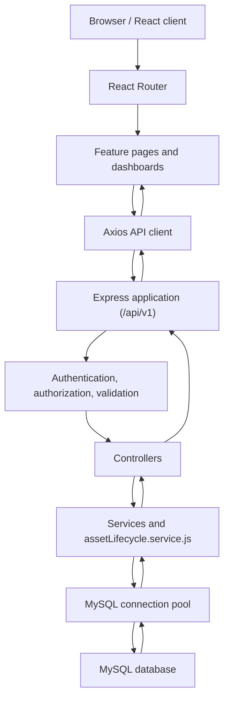
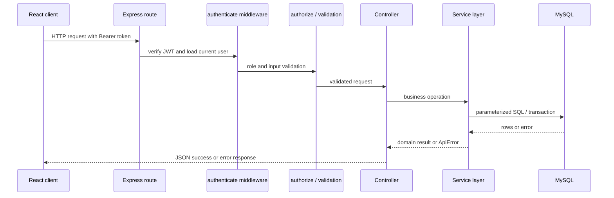
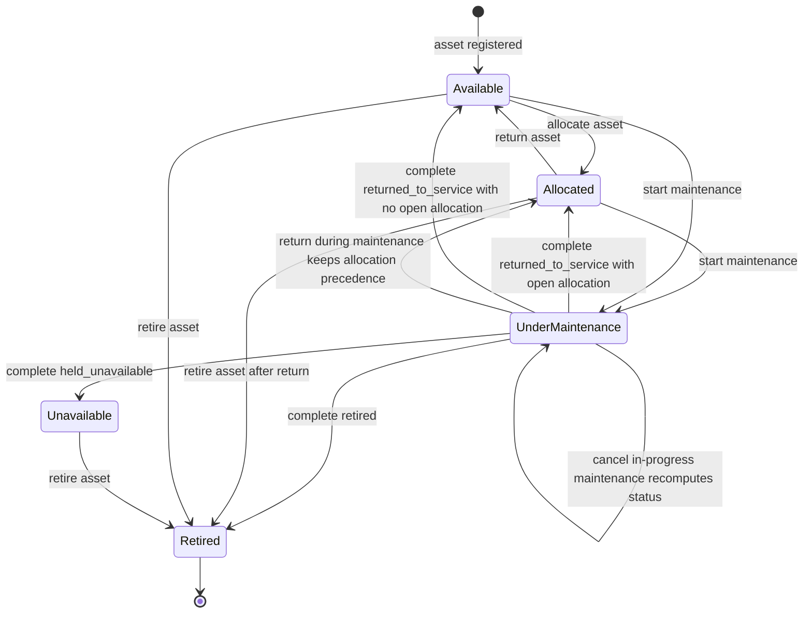
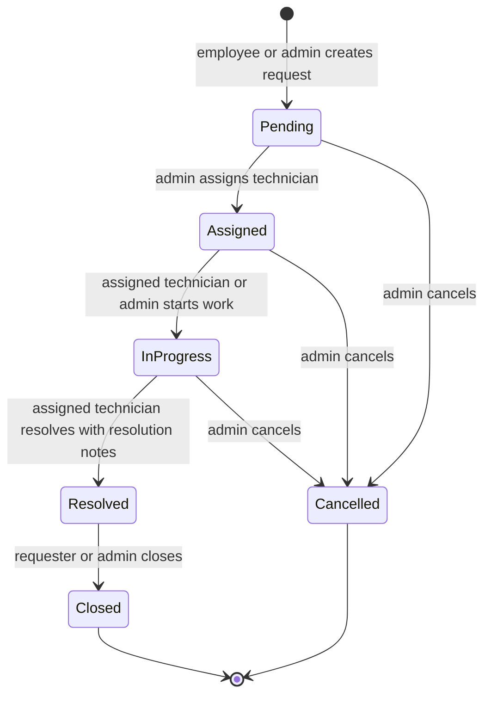

# EITAMS Architecture and Workflow Diagrams

Product identity: **Nexora — IT Operations Suite**

## A. System architecture diagram

This diagram shows the implemented three-tier architecture and the direction of requests and
responses. Database access is owned by the service layer; controllers do not access the
database directly.

## B. Backend request-flow diagram

This sequence shows a typical authenticated API request, including validation and error
handling.

## C. Asset lifecycle workflow

This diagram shows the implemented asset lifecycle. `assetLifecycle.service.js` recomputes
asset status inside the same transaction as the causing operation.

Maintenance completion outcomes:

- `returned_to_service`
- `held_unavailable`
- `retired`

Scheduled maintenance does not automatically change asset status. It becomes in-progress only
when started.

## D. Service request workflow

This diagram shows the implemented request lifecycle and transition ownership.

Every transition, including creation, writes `request_status_history`. Invalid or repeated
transitions return `409 INVALID_REQUEST_TRANSITION`.
