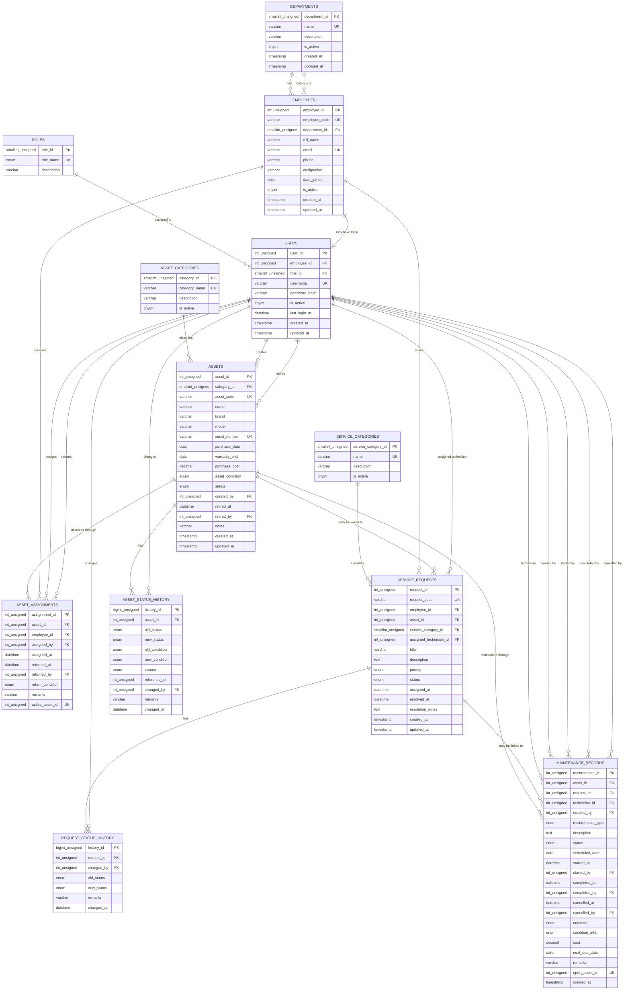

# EITAMS Entity-Relationship Diagram

Product identity: **Nexora — IT Operations Suite**

This document describes the implemented MySQL schema for the Enterprise IT Asset & Service
Management System. It is based on `database/schema.sql` and the backend services that use it.

## ER diagram

## Table purposes

| Table | Purpose |
|---|---|
| `departments` | Organisation units used by employees and reports. |
| `employees` | Employee master records. |
| `roles` | Application roles: admin, employee, technician. |
| `users` | Login accounts linked one-to-one to employees. |
| `asset_categories` | Controlled vocabulary for asset registration. |
| `assets` | Asset master records and derived status cache. |
| `asset_assignments` | Allocation and return history, including one open allocation per asset. |
| `service_categories` | Controlled vocabulary for service requests. |
| `service_requests` | Employee-raised service requests and assignments. |
| `request_status_history` | Append-only request status transition audit. |
| `maintenance_records` | Scheduled and immediate maintenance lifecycle records. |
| `asset_status_history` | Append-only asset status and condition audit. |

## Constraints and generated columns

- `asset_assignments.active_asset_id` is a stored generated column equal to `asset_id` when
  `returned_at IS NULL`, otherwise `NULL`. Its unique key enforces at most one open
  allocation per asset.
- `maintenance_records.open_asset_id` is a stored generated column equal to `asset_id` when
  `status = 'in_progress'`, otherwise `NULL`. Its unique key enforces at most one
  in-progress maintenance record per asset.
- Foreign keys use `ON DELETE RESTRICT` for most relationships. `maintenance_records.request_id`
  uses `ON DELETE SET NULL`.
- CHECK constraints enforce active flags, warranty ranges, purchase cost, retirement pairs,
  assignment return timing and actor pairing, request resolved timestamps, maintenance field
  sets and completion ordering.
- `asset_status_history.reference_id` is polymorphic by design and is not a foreign key.

## `v_asset_history`

`v_asset_history` is a database view, not a base table. It consolidates lifecycle events
from `assets`, `asset_assignments`, `maintenance_records` and `asset_status_history` so that
registration, allocation, return, maintenance scheduled/started/completed/cancelled, manual
edits and direct retirement appear once. Allocation, return and maintenance events are read
from their domain tables, while audit-only manual edits and retirements are read from
`asset_status_history`.
